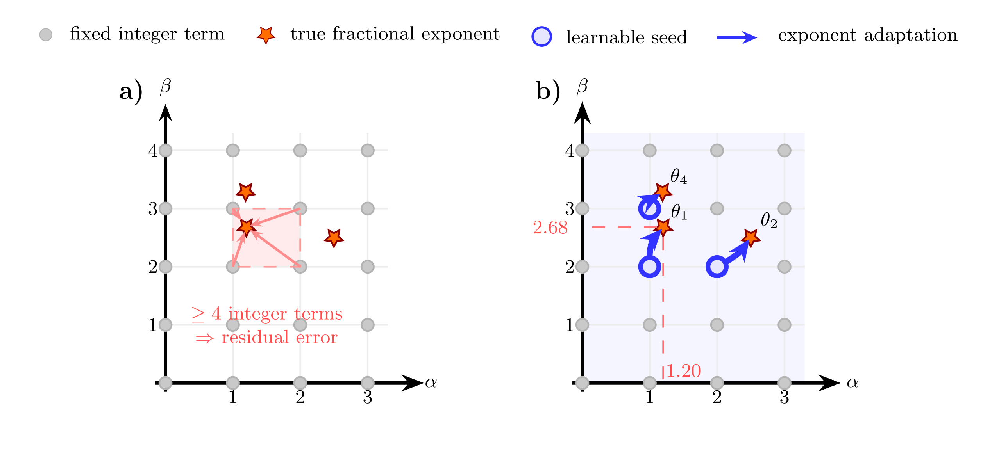
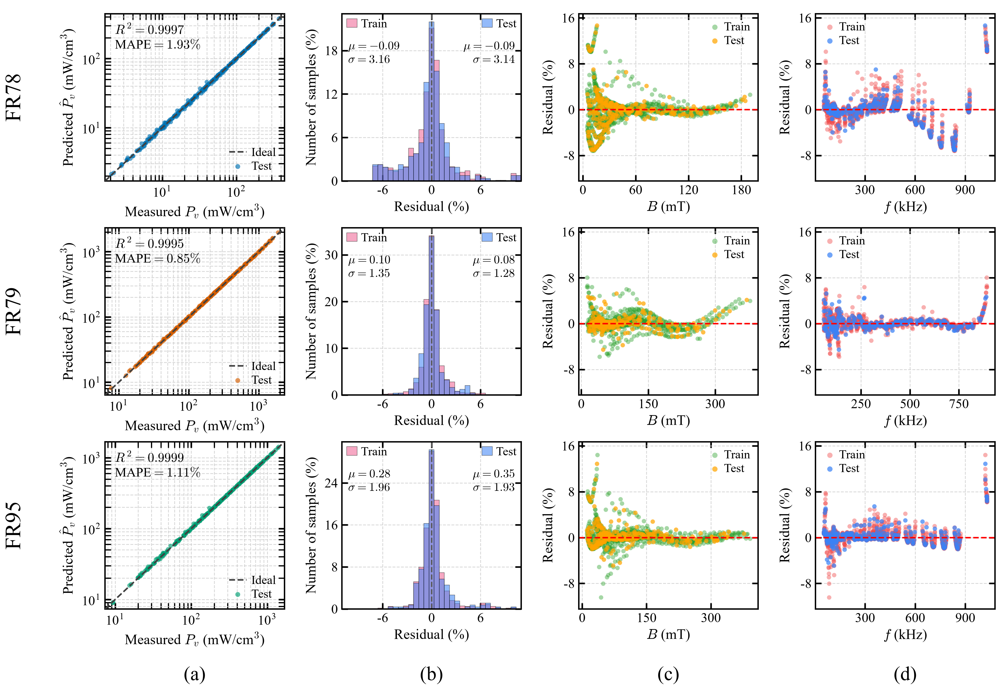
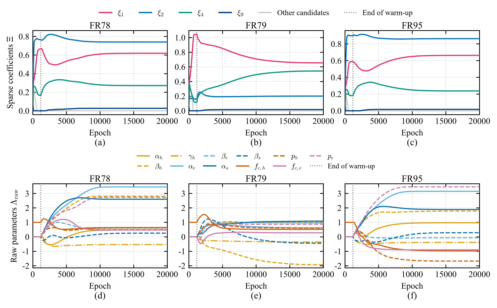

<div align="center">


# **Learnable Symbolic Sparse Identification for Magnetic Core Loss**

Discover compact, explicit core-loss equations from measurements —
**four shared terms across three ferrites**, with held-out errors of **0.85–1.93%**.

[](https://www.python.org/)
[](https://pytorch.org/)
[](LICENSE)
[](tests)

</div>

---

## Overview

**Learnable Symbolic Sparse Identification (LSSI)** learns an analytical equation
`P_v(f, B)` from measured magnetic core loss. Ten physics-guided candidate
functions compete through nonnegative coefficients, while their exponents and
high-frequency roll-off parameters adapt continuously. The final expression
can be inspected, differentiated, and embedded in magnetic-component design.



The current experiments cover **Fair-Rite 78 (FR78), Fair-Rite 79 (FR79), and
Fair-Rite 95 (FR95)** under sinusoidal excitation at 25 °C. All three use the
same library, bounds, penalties, and training schedule. Only the learned
coefficients and internal parameters differ.

### Key features

- **Continuous parameter learning** — fit fractional scaling directly rather than selecting neighboring fixed exponents.
- **Shared compact structure** — four retained candidates describe hysteresis-like, eddy-current-like, high-flux, and linear-flux behavior.
- **Stable joint training** — bounded coordinates and a weak explicit raw-coordinate regularizer limit parameter drift.
- **Permanent pruning** — a delayed threshold selects the support, followed by contribution-based cleanup and refinement.
- **Reproducible evaluation** — seeded runs, material-specific units, training-only normalization, and a deterministic 80/20 interleaved split.

These terms describe effective macroscopic behavior; they do not establish a
unique microscopic decomposition of aggregate measured loss.

---

## Results — three ferrite materials

Mean absolute percentage error (**MAPE**), root-mean-square error (**RMSE**),
and coefficient of determination (**R²**) are evaluated on held-out samples.

| Material | Train / test samples | Train MAPE | Test MAPE | Test RMSE (mW/cm³) | Test R² | Active terms |
|---|---:|---:|---:|---:|---:|---:|
| FR78 | 1056 / 264 | 1.97% | **1.93%** | 1.17 | 0.9997 | **4 / 10** |
| FR79 | 992 / 248 | 0.85% | **0.85%** | 7.65 | 0.9995 | **4 / 10** |
| FR95 | 1056 / 264 | 1.13% | **1.11%** | 3.52 | 0.9999 | **4 / 10** |

<div align="center">

<br><em>Rows: FR78, FR79, FR95. Columns: held-out parity, residual distribution,
residual versus flux density, and residual versus frequency.</em>
</div>

The tests evaluate interpolation within the measured domains. Local residual
bands and boundary excursions remain visible.

### The common equation

With `F = f/f_n`, `b = B/B_n`, and `p = P_v/P_n`, all three materials retain

```text
p = xi_h · F^alpha_h · b^(beta_h + gamma_h·ln(b+epsilon)) · R_h(F)
  + xi_e · F^alpha_e · b^beta_e · R_e(F)
  + xi_s · F^alpha_s · b^beta_s
  + xi_B · b

R_h(F) = 1 / (1 + (F/F_c,h)^p_h)
R_e(F) = 1 / (1 + (F/F_c,e)^p_e)
```

Each equation has **4 coefficients and 11 internal parameters**. Full-precision
reference parameters and training-mean normalization constants are available in
**[reference_results](reference_results/)**.

### LSSI and fixed-library SSI

The companion **[Symbolic Sparse Identification (SSI)](SSI/)** learns
coefficients over 103 fixed candidates.
Reference metrics and numerical settings are provided in `reference_results/`.

| Material | SSI test MAPE | SSI terms | LSSI test MAPE | LSSI terms |
|---|---:|---:|---:|---:|
| FR78 | **1.90%** | 9 | 1.93% | **4** |
| FR79 | 1.01% | 11 | **0.85%** | **4** |
| FR95 | 1.596% | 7 | **1.11%** | **4** |

LSSI reduces mean test MAPE from 1.50% to 1.30% while retaining four terms.
SSI has a small accuracy advantage on FR78. Fewer symbolic terms do not imply
fewer learned quantities: LSSI has 15, versus SSI's 7–11 retained coefficients.

---

## Installation

```bash
git clone https://github.com/Aaron-H-Wang/LSSI.git
cd LSSI
pip install -r requirements.txt
pip install -e .
```

Requires Python 3.9+ and PyTorch 2.0+. Result images are prepared assets;
the public code focuses on training, evaluation, and prediction.

## Quick start

Run from the repository root:

```bash
# Pipeline check; does not reproduce the reference table.
python scripts/train.py --config configs/quick.yaml

# Identical full training schedule for all three materials.
python scripts/train.py --config configs/fr78.yaml
python scripts/train.py --config configs/fr79.yaml
python scripts/train.py --config configs/fr95.yaml

python scripts/evaluate.py --checkpoint results/fr95/model.pt
python scripts/predict.py --checkpoint results/fr95/model.pt --freq 100e3 300e3 --flux 50 100
```

Prediction inputs use **Hz** and **mT**; outputs use **mW/cm³**. Checkpoints
store the dataset's unit-conversion and split settings. Each run writes:

```text
model.pt        model and experiment configuration
equation.txt    the discovered analytical expression
summary.json    metrics, physical parameters, and normalization constants
history.json    objective and parameter trajectories
```

### Training in brief

| Stage | Updated quantities | Shared setting |
|---|---|---|
| Coefficient warm-up | Coefficients; nonlinear coordinates frozen | 1200 epochs, learning rate 0.01 |
| Joint discovery | Coefficients and nonlinear coordinates | 40,000 epochs, initial learning rate 0.001 |
| Delayed pruning | Permanent support mask during joint discovery | Last 25%; checked every 100 epochs |
| Support-fixed refinement | Surviving coefficients and internal parameters | Limited-memory Broyden–Fletcher–Goldfarb–Shanno (L-BFGS), contribution audit, final refit |

Adaptive moment estimation with decoupled weight decay (**AdamW**) applies
weight decay **only to coefficients**. The objective
equally weights logarithmic squared error and relative absolute error, plus
`2.5e-4 · mean(raw_coordinates²)`. After polishing, terms below **0.1%** mean
absolute contribution are removed, subject to retaining at least two terms.
The explicit coordinate regularizer remains active during refinement.

<div align="center">

<br><em>The first 20,000 epochs. Colored coefficients belong to the final retained
support; gray curves belong to candidates eventually discarded.</em>
</div>

Details: **[method](docs/method.md)** · **[usage](docs/usage.md)** ·
**[data and units](data/README.md)** · **[reference results](reference_results/README.md)**.

## Repository structure

```text
lssi/                 model, objective, trainer, metrics, equation export
scripts/              train / evaluate / predict commands
configs/              FR78, FR79, FR95, and quick-run settings
data/                 measurements and unit conventions
reference_results/    archived metrics and identified parameters
assets/               selected result images
SSI/                  fixed-library companion for all three materials
docs/                 method and usage notes
design/logo/          original logo assets
tests/                data, model, and training checks
```

## Tests

```bash
pytest
cd SSI
pytest
```

The suites cover data splitting, bounded parameters, permanent masks,
raw-coordinate regularization, contribution cleanup, and short training runs.
Full-run values can vary slightly with numerical libraries and hardware.

---

## Citation

The original method description appears in this preprint. The repository now
also includes the three-material experiments summarized above.

```bibtex
@misc{wang2026discoveringexplicitmagneticcore,
  title={Discovering Explicit Magnetic Core Loss Equations via Learnable Symbolic Sparse Identification},
  author={Haoyu Wang and Jialin Zheng and Yihao Wu and Ziyang Xu and Alex Hanson},
  year={2026},
  eprint={2608.00379},
  archivePrefix={arXiv},
  primaryClass={eess.SY},
  url={https://arxiv.org/abs/2608.00379}
}
```

**[Preprint](https://arxiv.org/abs/2608.00379)** ·
**[Original repository](https://github.com/Aaron-H-Wang/LSSI_old)**

## License

Released under the [MIT License](LICENSE).
