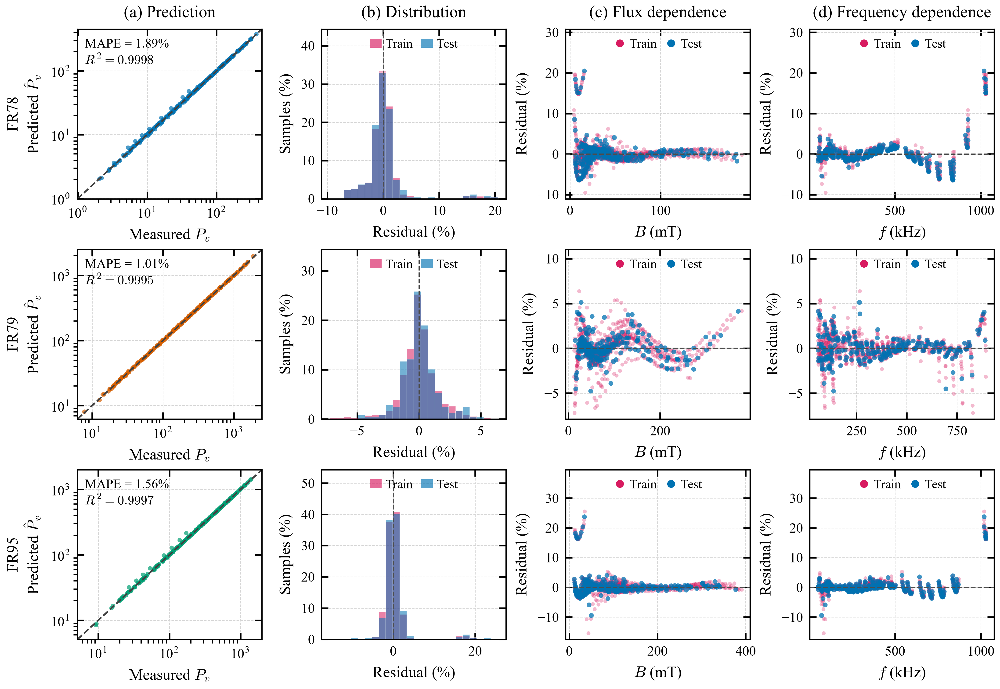
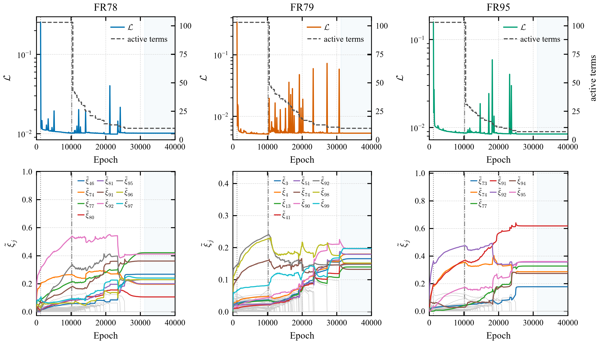

<div align="center">

# **Symbolic Sparse Identification of Magnetic Core Loss**

Discover compact, explicit core-loss equations from measurements —
**7–10 retained terms from 103 fixed candidates**, with held-out errors of **1.01–1.89%**.

[](https://www.python.org/)
[](https://pytorch.org/)
[](LICENSE)

</div>

---

## Overview

**Symbolic Sparse Identification (SSI)** discovers an analytical core-loss
equation `P_v(f, B)` by selecting a small number of physics-guided functions
from a fixed library. Nonnegative coefficients describe retained amplitudes,
while fractional exponents and roll-off parameters are specified before training.
The equation can be inspected, differentiated, and used in magnetic-component design.

The experiments cover **Fair-Rite 78 (FR78), Fair-Rite 79 (FR79), and Fair-Rite 95
(FR95)** under sinusoidal excitation at **25 °C**. All three materials use the
same 103 candidates, loss weights, and discovery settings.

### Key features

- **Physics-guided library** — power laws, high-frequency roll-off, logarithmic corrections, high-flux functions, and low-order auxiliaries.
- **Nonnegative coefficient fitting** — projected AdamW updates retain nonnegative amplitudes.
- **Comparable scales** — training-only root-mean-square column scaling supports a shared pruning threshold.
- **Permanent sparse support** — delayed threshold masking removes weak candidates, followed by support-fixed refinement.
- **Explicit equations** — export retained functions, coefficients, and normalization constants.
- **Consistent evaluation** — training-only normalization and a deterministic, sorted 80/20 interleaved split.

These functions represent effective macroscopic behavior. Nonnegative coefficients
do not identify a unique microscopic loss decomposition: logarithmic correction
functions can change sign within the measured domain.

---

## Results — three ferrite materials

Mean absolute percentage error (**MAPE**), root-mean-square error (**RMSE**),
and coefficient of determination (**R²**) are evaluated on held-out samples.
These are the updated saved SSI paper results; full-precision values are in
**[reference_results](reference_results/)**.

| Material | Train / test samples | Train MAPE | Test MAPE | Test RMSE (mW/cm³) | Test R² | Active terms |
|---|---:|---:|---:|---:|---:|---:|
| FR78 | 1056 / 264 | 1.91% | **1.89%** | 1.13 | 0.9998 | **10 / 103** |
| FR79 | 992 / 248 | 1.04% | **1.01%** | 7.52 | 0.9995 | **10 / 103** |
| FR95 | 1056 / 264 | 1.58% | **1.56%** | 5.61 | 0.9997 | **7 / 103** |

<div align="center">

<br><em>Rows: FR78, FR79, FR95. Columns: held-out prediction versus measurement,
residual distribution, residual versus flux density, and residual versus frequency.</em>
</div>

The test split evaluates interpolation within the measured domains. Residual
bands and boundary excursions remain visible even when aggregate MAPE is low.

### The identified equation

Training means define the normalized frequency, flux density, and loss:

$$
\bar f=\frac{f}{f_n},\qquad
\bar B=\frac{B}{B_n},\qquad
\bar P_v=\frac{P_v}{P_{v,n}}.
$$

SSI identifies

$$
\hat{\bar P}_v(\bar f,\bar B)
=\sum_{j=1}^{103}\xi_j\theta_j(\bar f,\bar B),
\qquad \xi_j\geq 0,
\qquad \hat P_v=P_{v,n}\hat{\bar P}_v.
$$

Only retained coefficients are nonzero. Original library indices are preserved
in equations and trajectories. Exported coefficients have column scaling removed
and multiply functions of normalized inputs.

### Candidate library

| Family | Fixed functions | Candidates |
|---|---|---:|
| Power laws | An 8 × 9 fractional-exponent grid plus one 1.5/1.5 term | 73 |
| High-frequency roll-off | Three power-law pairs with six cutoff frequencies | 18 |
| Logarithmic correction | Three power-law pairs multiplied by logarithmic functions | 6 |
| High-flux response | Two exponential functions with fixed flux scales | 2 |
| Auxiliary terms | Frequency–flux product, frequency, flux density, and constant | 4 |
| **Total** | | **103** |

Exact grids and definitions: **[method](docs/method.md)**.

---

## Installation

```bash
git clone https://github.com/Aaron-H-Wang/LSSI.git
cd LSSI/SSI
pip install -r requirements.txt
pip install -e .
```

Requires Python 3.9+ and PyTorch 2.0+. Measurement files are included in `data/`.

## Quick start

Run from `LSSI/SSI`:

```bash
# Pipeline check with a reduced library and shorter schedule.
python scripts/train.py --config configs/quick.yaml

# Standard full discovery schedule for each material.
python scripts/train.py --config configs/fr78.yaml
python scripts/train.py --config configs/fr79.yaml
python scripts/train.py --config configs/fr95.yaml

python scripts/evaluate.py --checkpoint results/fr95/model.pt
python scripts/predict.py --checkpoint results/fr95/model.pt --freq 100e3 300e3 --flux 50 100
```

Prediction inputs use **Hz** and **mT**; outputs use **mW/cm³**. Each run writes:

```text
model.pt        model and experiment configuration
equation.txt    the discovered analytical expression
summary.json    metrics, retained coefficients, and normalization constants
history.json    objective, support, and coefficient trajectories
```

These commands run the packaged trainer. The paper reference runs additionally
include fixed-support AdamW continuation before final refinement; this continuation
is not enabled by the packaged defaults. CPU threads and PyTorch versions can also
change which neighboring fixed-grid terms survive. Saved predictions and
coefficients in `reference_results/` identify the runs reported above.

### Training in brief

The objective equally weights logarithmic squared error and relative absolute
error. **AdamW** applies decoupled weight decay to coefficients; nonnegative
projection and threshold masking impose exact zeros. No explicit ℓ₁ penalty is used.

| Stage | Purpose | Packaged full-run setting |
|---|---|---|
| Coefficient warm-up | Establish coefficient scales without decay | 1200 updates; learning rate 0.01 |
| Sparse discovery | Fit coefficients with AdamW | 30,001 updates; initial learning rate 0.005; decay 0.05 |
| Delayed pruning | Permanently remove weak candidates during discovery | After 30%; every 250 updates; threshold ramps to 0.1 |
| Support-fixed refinement | Polish, remove negligible contributions, and refit | L-BFGS: up to 200 calls, then up to 100; contribution threshold 0.5% |

Pruning is skipped if fewer than two candidates would remain. After a mask
change, the AdamW optimizer and plateau scheduler are reset.

<div align="center">

<br><em>Top: objective and number of active terms. Bottom: column-scaled
coefficients; colored curves identify final support, and gray curves identify
discarded candidates. Displayed interval: 0–40,000 cumulative epochs.</em>
</div>

In this saved history, **1200** marks the end of warm-up; **approximately 10,200**
marks pruning-ramp onset. Original discovery ends at approximately **31,200**
cumulative epochs. The lightly shaded interval shows subsequent fixed-support
AdamW continuation. All three trajectories pass the recorded stability check
over **35,000–40,000** epochs. The archive retains complete continuation
through 60,000 epochs and final refined results.

Details: **[method](docs/method.md)** · **[usage](docs/usage.md)** ·
**[data and units](data/README.md)** · **[reference results](reference_results/README.md)**.

## Directory structure

```text
ssi/                  library, model, objective, trainer, metrics, equation export
scripts/              train / evaluate / predict commands
configs/              FR78, FR79, FR95, and quick-run settings
data/                 measurements and raw-unit conventions
assets/               updated validation and training figures
reference_results/    paper metrics, coefficients, predictions, and saved histories
docs/                 method and usage notes
tests/                data, library, model, and training checks
```

## Tests

```bash
pytest
```

## License

Released under the [MIT License](LICENSE).
