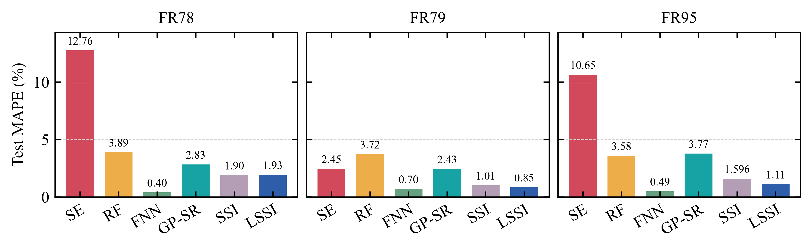

<div align="center">

# SSI

**Symbolic Sparse Identification of Magnetic Core Loss**

Discover explicit equations from **103 fixed candidate functions**.

[](https://www.python.org/)
[](https://pytorch.org/)
[](LICENSE)
[](tests)

</div>

---

## Overview

**Symbolic Sparse Identification (SSI)** learns nonnegative coefficients over
a fixed library of power laws, high-frequency roll-offs, logarithmic corrections,
saturation functions, and low-order auxiliaries. It is the fixed-grid baseline
for **[Learnable Symbolic Sparse Identification (LSSI)](../)**.

SSI selects columns; LSSI also adapts their internal parameters. Both use the
same sorted 80/20 interleaved samples for Fair-Rite 78 (FR78), Fair-Rite 79
(FR79), and Fair-Rite 95 (FR95), under sinusoidal excitation at 25 °C.

### Key features

- **103 fixed candidates** and configurable exponent/roll-off grids.
- **Training-only root-mean-square column normalization** for comparable coefficients.
- **Irreversible pruning**, with optimizer and scheduler reset after removals.
- **Support-fixed refinement** and contribution-based cleanup.
- **Three material configurations** with explicit raw-unit conversion.

Logarithmic correction columns can be signed even with nonnegative coefficients.
Contribution shares therefore use mean absolute outputs.

---

## Results — three ferrite materials

Mean absolute percentage error (**MAPE**) is evaluated on held-out measurements.
The table and image below summarize the reference results.

| Material | Train / test samples | SSI test MAPE | SSI terms | LSSI test MAPE | LSSI terms |
|---|---:|---:|---:|---:|---:|
| FR78 | 1056 / 264 | **1.90%** | 9 / 103 | 1.93% | **4 / 10** |
| FR79 | 992 / 248 | 1.01% | 11 / 103 | **0.85%** | **4 / 10** |
| FR95 | 1056 / 264 | 1.596% | 7 / 103 | **1.11%** | **4 / 10** |

SSI has a small FR78 accuracy advantage. Across the three materials, LSSI has
lower mean test MAPE with fewer terms. Its internal parameters are learned,
so four terms do not imply fewer learned quantities than SSI's 7–11 coefficients.

<div align="center">

<br><em>Same-split comparison. SE: Steinmetz equation; RF: random forest;
FNN: feedforward neural network; GP-SR: genetic programming-based symbolic regression.</em>
</div>

See [reference results](../reference_results/) for metrics, identified term
coefficients, normalization constants, and training settings.

## Installation and quick start

```bash
git clone https://github.com/Aaron-H-Wang/LSSI.git
cd LSSI/SSI
pip install -r requirements.txt
pip install -e .

python scripts/train.py --config configs/quick.yaml
python scripts/train.py --config configs/fr78.yaml
python scripts/train.py --config configs/fr79.yaml
python scripts/train.py --config configs/fr95.yaml
python scripts/evaluate.py --checkpoint results/fr95/model.pt
python scripts/predict.py --checkpoint results/fr95/model.pt --freq 100e3 300e3 --flux 50 100
```

The quick configuration checks a reduced library and shorter schedule, not the
reference results. Prediction uses Hz and mT; predicted loss is mW/cm³.

## Training in brief

Training uses adaptive moment estimation with decoupled weight decay (**AdamW**)
before support-fixed refinement.

| Stage | Purpose | Full-run setting |
|---|---|---|
| Warm-up | Fit normalized coefficients without decay | 1200 epochs, learning rate 0.01 |
| Discovery | AdamW, ramped pruning, optimizer resets | 30,001 epochs, learning rate 0.005, decay 0.05 |
| Polishing | Limited-memory Broyden–Fletcher–Goldfarb–Shanno (L-BFGS) on surviving coefficients | Up to 200 calls |
| Cleanup and refit | Remove negligible output contributions and refit | Below 0.5%; at least two survivors; up to 100 calls |

Pruning begins after 30% of discovery, is checked every 250 epochs, and ramps to
0.1 on normalized coefficients. The objective equally weights logarithmic squared
error and relative absolute error. SSI does not learn nonlinear coordinates.

Each run writes `model.pt`, `equation.txt`, `summary.json`, and `history.json`.
Packaged SSI runs use 12 CPU threads for all three materials. Other thread
settings can change which neighboring fixed-grid terms survive, even when
the prediction errors remain similar.
Details: **[method](docs/method.md)** · **[usage](docs/usage.md)** · **[data](data/README.md)**.

## Tests

```bash
pytest
```

## License

Released under the [MIT License](LICENSE).
